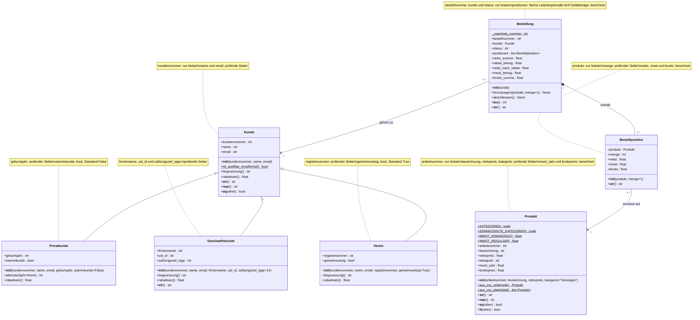

# Bestelo – Gruppe 3

Bestelo zeigt Kunden, Produkte und Bestellungen eines allgemeinen Shopsystems.

## Starten

Voraussetzungen: Python ab 3.10 und pytest.

Alle Befehle im Ordner ausführen, der Bestelo, Tests und pytest.ini enthält.

python -m pip install pytest
python -m Bestelo
python -m pytest -v (alle tests gleichzeitig)

- Beispiel: Nur die Kundentests im Terminal starten

python -m pytest Tests/test_kunde.py -v

Die Demo enthält eine Firmenbestellung über 79,66 € und eine
Vereinsbestellung über 75,97 €.

## Dateien

- Bestelo/Kunden.py: Kunde, Privatkunde und Geschäftskunde
- Bestelo/Verein.py: Verein
- Bestelo/Produkte.py: Produkt und CSV-Import
- Bestelo/Bestellungen.py: Bestellposition und Bestellung
- Bestelo/__main__.py: Konsolen-Demo
- Bestelo/Daten/Produkte.csv: sechs vorgegebene Produkte
- Tests: 18 Tests, verteilt auf fünf Dateien

## UML-Klassendiagramm

### Legende

- `+` bedeutet öffentlich; `-` kennzeichnet interne Elemente.
- `$` kennzeichnet klassenbezogene Attribute und Methoden.
- `<|--` bedeutet Vererbung.
- `-->` bedeutet eine Beziehung zu einem anderen Objekt.
- `*--` bedeutet Komposition: Die Positionen gehören zur Bestellung.
- `1` bedeutet genau ein Objekt.
- `0..*` bedeutet beliebig viele Objekte, einschließlich keines.
- Geerbte Eigenschaften und Methoden werden in Unterklassen nicht erneut aufgeführt.