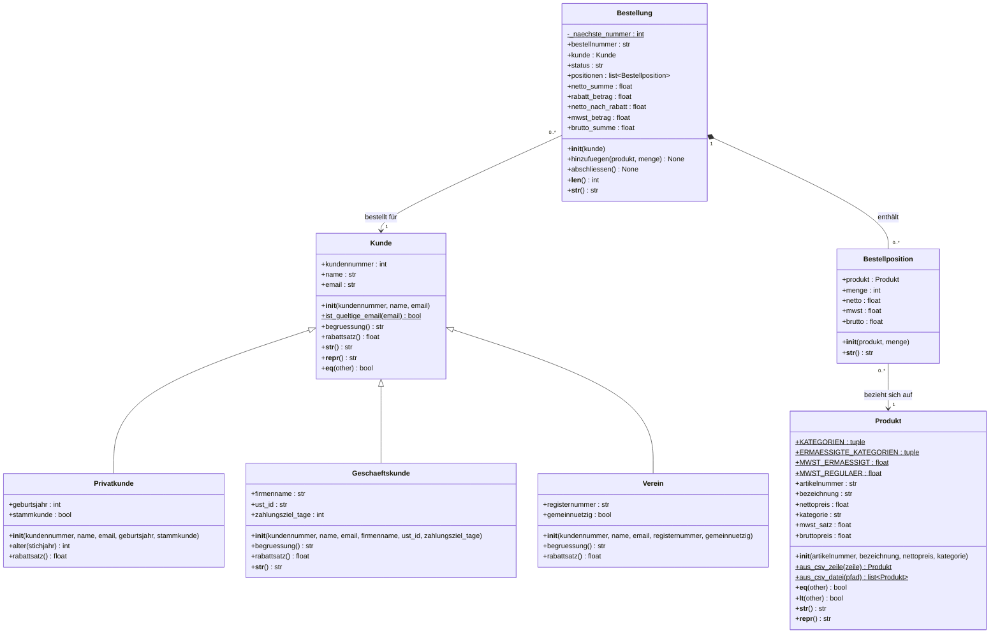

# Bestelo · Gruppe 3 · Lernfassung

Diese eigenständige Lernfassung zeigt, wie Kunden, Sortiment und Bestellungen zusammenspielen. Die Phase-1-Abgabe eurer Gruppe entsteht laut Aufgabenblatt eigenständig. Die Rollen unten beschreiben die Aufgabenverteilung der Übung.

## In VS Code starten

Öffne den Ordner **gruppe 3** (hier liegen diese README und die pytest.ini). Öffne darin ein Terminal. Du brauchst Python ab 3.10. Für die Demo genügt die Standardbibliothek.

```powershell
python -m bestelo
python -m pytest
```

Falls pytest in diesem Python fehlt, installiere es mit `python -m pip install pytest`. Mit `python -m pytest -v` siehst du die einzelnen Testfälle. Um nur die Kundenbasis zu üben, verwende `python -m pytest tests/test_kunde.py -v`.

## Rollenübersicht

Gruppennummer **3** wurde aus dem Ordnernamen übernommen. Namen, GitHub-Namen und Teamleitung sind noch einzutragen. Eine der fünf Personen übernimmt zusätzlich die Teamleitung. Die vorhandenen Striche sind Platzhalter und keine vollständigen Teamangaben.

| Rolle | Name | GitHub | Eigene Klassen / Aufgaben | Tests |
|---|---|---|---|---|
| 1 | – | – | Kunde und Privatkunde in kunden.py | test_kunde.py |
| 2 | – | – | Geschaeftskunde und Verein in derselben Datei | test_kundentypen.py |
| 3 | – | – | Produkt, CSV-Datei und Import | test_produkt.py |
| 4 | – | – | Bestellposition und Bestellung | test_bestellung.py |
| 5 | – | – | Demo in __main__.py, README, Diagramm und Integration | test_integration.py |

## Vom Objekt zum Beleg

1. Lies zuerst **bestelo/kunden.py** und **tests/test_kunde.py** nebeneinander. Alle vier Kundenklassen stehen auf derselben Einrückungsebene. Der Konstruktor von Kunde setzt den Namen über die Property. So gilt dieselbe Prüfung beim Anlegen und beim späteren Ändern.
2. In **bestelo/produkte.py** baut die Klassenmethode aus jeder Datenzeile ein Produkt. Die Artikelnummer bestimmt die Gleichheit, der Nettopreis die Sortierung. Deshalb kann das günstigste Produkt eine höhere Artikelnummer haben.
3. In **bestelo/bestellungen.py** gehört jeder Bestellung ein Kunde. Der Aufruf seiner Methode `rabattsatz()` liefert je nach Kundentyp einen anderen Wert. Die Liste der Positionen wird beim Lesen flach kopiert. Das Leeren dieser Kopie lässt die Bestellliste intakt.
4. Folge in **bestelo/__main__.py** den Bestellungen von den CSV-Artikeln bis zur Ausgabe. Der Dateipfad wird aus dem Speicherort des Moduls gebildet.

### Rechenprobe

| Posten | Nettobetrag | Steuer vor Rabatt |
|---|---:|---:|
| 3 × Kaffeebohnen zu 8,90 € | 26,70 € | 1,87 € |
| 6 × Mineralwasser zu 7,50 € | 45,00 € | 8,55 € |

71,70 € netto minus 2,15 € Firmenrabatt ergeben 69,55 €. Auch die Steuer sinkt um 3 %: Aus 10,42 € werden 10,11 €. Zusammen ergibt das **79,66 € brutto**. Beim gemeinnützigen Verein ergeben 24 × Orangensaft mit 5 % Rabatt **75,97 € brutto**. Jeder berechnete Geldbetrag wird mit Python-`round(..., 2)` gerundet.

## UML-Klassendiagramm

Die Dreieckspfeile zeigen auf die gemeinsame Basisklasse. Die ausgefüllte Raute verbindet eine Bestellung mit ihren Positionen. In einer Markdown-Vorschau mit Mermaid-Unterstützung erscheint der folgende Block als Diagramm.



## Ideen für Phase 2

Ein Hofladen könnte Pfandartikel getrennt ausweisen. Ein Warenkorb könnte vor der Bestellung eine Mengenänderung ermöglichen. Für gespeicherte Bestellungen wäre ein JSON-Export ein nächster Schritt.


## Abgleich mit der Phase-1-Aufgabe

Grundlage ist „BW220 - Projekt Bestelo - Phase 1 (2).pdf“, 34 Seiten. Der Abgabetermin auf Seite 1 ist Donnerstag, 05.11.2026, 18:00 Uhr. Gefordert sind mindestens 18 Tests, verteilt auf die fünf Rollen (4/4/4/4/2).

Die maßgebliche Implementierung der vier Kundenklassen liegt gemeinsam in **bestelo/kunden.py**. Die Dateien **kunde.py** und **kunden_typen.py** im obersten Ordner importieren diese Klassen nur noch für frühere Aufrufe. Dadurch verwenden beide Importwege dieselben Klassen.

Im UML kennzeichnet ein angehängtes Dollarzeichen klassenbezogene Elemente. Nur lesbar sind Kundennummer, Artikelnummer, Produkt einer Bestellposition sowie Nummer, Kunde, Status und Positionsliste einer Bestellung. Berechnet werden Produktsteuer und Bruttopreis, die drei Positionsbeträge und die fünf Bestellsummen. Name, E-Mail, Geburtsjahr, Firmendaten, Registernummer, Bezeichnung, Nettopreis, Kategorie und Menge haben prüfende Setter. Stammkundenstatus und Gemeinnützigkeit sind einfache bool-Attribute.

Die Positionsliste wird entsprechend Seite 27 flach kopiert. Die enthaltenen Positionen und ihre Produkte bleiben referenzierte, veränderbare Objekte. Der Bestellabschluss sperrt die Methode hinzufuegen(). Unveränderliche historische Rechnungen mit eingefrorenen Preisen und Rabatten würden ein erweitertes Modell erfordern.

### Noch durch das Team zu erledigen oder nachzuweisen

- [ ] Namen und GitHub-Namen eintragen und Teamleitung markieren.
- [ ] Die eigenen Ideen für Phase 2 bestätigen oder anpassen.
- [ ] Öffentliches Gruppenrepository bereitstellen und alle Mitglieder hinzufügen.
- [ ] Link mit Gruppennummer und Mitgliedern dem Lehrbeauftragten schicken.
- [ ] Eigenständige Beiträge und eigene Testdateien je Person im Git-Verlauf nachweisen.
- [ ] Gegenseitiges Review durchführen und die Klassen erklären können.
- [ ] Den Abgabestand in einen neuen Ordner klonen und darin beide Startbefehle ausführen.
- [ ] Den fertigen Stand mit phase-1 markieren und den Tag vor 18:00 Uhr pushen.


